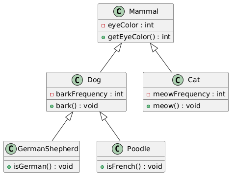
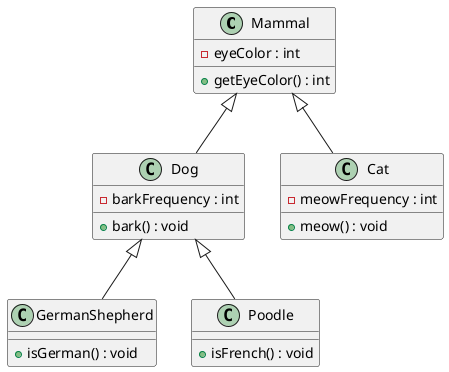
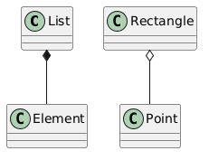
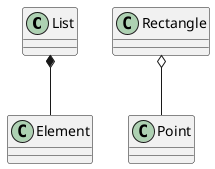
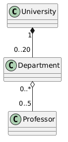
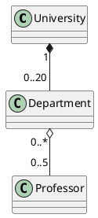
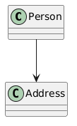
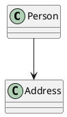
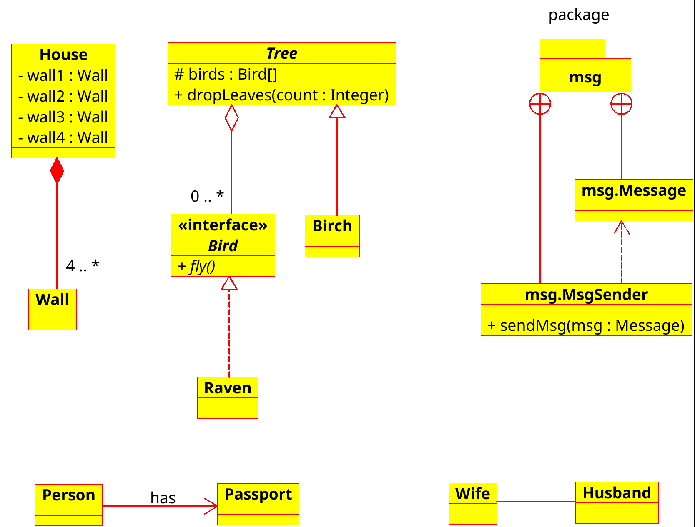

# Введение в ООП. Класс и объект. Абстрактный тип данных

## Учебные цели

После изучения главы студент сможет:

- объяснить, чем объектно-ориентированный подход отличается от процедурного, и какие задачи он решает лучше;
- определить понятия класс, объект, экземпляр, состояние, поведение, идентичность;
- описать тип данных через спецификацию и реализацию (АТД);
- формулировать предусловия, постусловия и инварианты для операций класса;
- читать UML-диаграмму класса и определять видимость членов;
- различать отношения между классами: зависимость, ассоциация, агрегация, композиция, наследование — и указывать их мощность.

## Мотивация

- Проблема процедурного подхода на примере C. Данные (struct) и функции разнесены по коду; компилятор не мешает любому коду менять поля напрямую и нарушать корректное состояние. Показать на коротком примере: struct с данными и функции поверх него, затем участок кода, который незаметно ломает инвариант.
- В Java от классов никуда не деться: даже программа `Hello, World!` — это класс с методом `main`. Класс — базовая единица организации кода.
- В Python студенты уже встречали `class`; в Java этот механизм устроен строже и работает всегда, а не по желанию автора.

## 1. Парадигмы программирования

TODO

- Императивные и декларативные парадигмы, краткая карта: процедурная, объектно-ориентированная, функциональная. Где применяются.
- Суть ООП в одном абзаце: данные и операции над ними объединяются в одном месте, доступ к состоянию контролируется, поведение объектов определяется их типом.
- Таблица сравнения подходов: как организуются данные и функции, кто отвечает за корректность состояния, как масштабируется программа при росте. C / Python / Java.

## 2. Класс и объект

TODO

- Класс — описание (тип, чертёж), объект — экземпляр класса в памяти (instance). Разница между «один класс — много объектов».
- Три характеристики объекта: состояние (поля), поведение (методы), идентичность (два объекта с одинаковыми полями — всё равно разные объекты).
- Сравнительная таблица: struct в C (только данные), class в Python (динамическая типизация, `__init__`, поля можно добавлять на ходу), class в Java (статическая типизация, состав класса фиксирован).
- Перекличка с главой про память: объект живёт в куче, переменная хранит ссылку. Пока сослаться на `20_memory.md`, не пересказывая её.
- Тизер синтаксиса: минимальный полный класс на Java (поля, конструктор, методы). Разбор деталей синтаксиса — в следующем разделе пособия.

## 3. Абстрагирование. Абстрактный тип данных

- Абстракция как выделение существенного и сокрытие деталей. Бытовая аналогия (пульт, кнопка) + программная.
- Абстрактный тип данных (abstract data type, ADT): спецификация (какие операции и какой у них контракт) отделена от реализации (как данные устроены внутри).
- Сквозной пример: стек. Спецификация АТД (push, pop, isEmpty, peek), затем две реализации — на массиве и на связном списке. Клиентский код не меняется.
- В C стек на struct + функциях возможен, но ничто не мешает клиенту испортить внутренние данные; в АТД-мышлении и классе Java реализация закрыта.
- Класс в Java — реализация АТД. Инвариант: сначала думаем «что он умеет», потом «как он устроен».

## 4. Предусловия, постусловия, инварианты

- Термины с английскими оригиналами: precondition, postcondition, class invariant.
- Определения: что обязуется обеспечить вызывающий, что гарантирует метод, что верно всегда после любого метода.
- Пример на классе Seconds (секунды 0–59): предусловие конструктора и сеттера, постусловие метода, инвариант поля.
- Сравнение с C: у функций тоже есть предусловия (валидный указатель, диапазон), но они живут в голове и в комментариях; в ООП контракт проверяется кодом класса и можно защитить программно.
- Что делать при нарушении предусловия: исключение (отсылка к главе про исключения).

## 5. UML-диаграмма класса

- Зачем: общий язык для описания дизайна до написания кода.
- Нотация: три секции (имя, поля, методы), запись видимости `+`, `-`, `#`, `~`, типы в UML-стиле.
- Схема класса Seconds из предыдущего раздела (нарисовать по навыку diagrams-as-code, сохранить в `img/`).
- Упражнение: прочитать чужую диаграмму и воспроизвести класс по ней (заготовка Cuboid).

## 6. Отношения между классами

Отношения между классами можно разделить на 3 категории:
- обобщение/специализация (generalization/specialization)\
кошки – это животные
- целое/часть (whole/part)\
двигатель – часть автомобиля
- ассоциация (семантическая зависимость)\
художник – кисть

#### Обобщение / специализация

<!--

-->

**Наследование** – построение новых классов на основе уже
существующих, при котором один класс (производный) получает все поля и методы базового, а также добавляет свои.

Базовый класс (предок) – класс на основе которого строится
определение нового класса - производного класса (потомка).

#### целое/часть (whole/part)
**Агрегация (aggregation)**: агрегирующий объект (list на рис. слева) может существовать и не включая в себя экземпляры агрегируемого (в примере atom)

**Композиция (composition)**: один объект (Rectangle на втором рис. слева) не может существовать без своих составляющих (в примере Point) Композиция – более строгий вариант агрегации.

Композиция связывает время жизни объектов: если контейнер будет уничтожен, то всё его содержимое будет также уничтожено.

<!--

-->

Агрегация: профессора – факультеты, профессора остаются жить после разрушения факультета

Композиция: университет – факультеты, факультеты без
университета погибают.

<!--

-->

Цифры у концов линии — это мощность связи (multiplicity). Число у конца линии показывает, сколько объектов класса с этого конца приходится на один объект класса с противоположного конца.

В примере выше `0..20` стоит у конца `Department`: один университет состоит из нуля или более (здесь — до 20) кафедр. А `1` у конца `University` означает, что каждая кафедра принадлежит ровно одному университету.

Аналогично `0..5` у конца `Professor` — у кафедры не более пяти профессоров, а `0..*` у конца `Department` — преподаватель может работать в любом числе кафедр.

Обозначения, которые встречаются чаще всего: `1` — ровно один, `0..1` — не более одного (связь необязательна), `0..*` или просто `*` — сколько угодно, `1..*` — хотя бы один.

**Наследование vs агрегация\композиция**\

Часто при построении иерархии классов приходится выбирать между наследованием и агрегацией (композицией)

Наследование – сильный вид отношения (сильнее привязывает классы друг к другу), поэтому к нему следует прибегать с осторожностью рассматривая в качестве альтернативы агрегацию.

#### Ассоциация
Ассоциация - самый слабый вид отношения из перечисленных.

Как правило при ассоциации один класс так или иначе использует объект другого класса, но не владеет им. Например один класс может хранить ссылку на другой, однако при удалении объекта первого класса, второй продолжит существовать. И при этом по смыслу объект одного класса не является частью другого.

Ассоциация может быть направленной (изображается стрелкой), а может и не иметь направления (без стрелки)

<!--

-->

#### ***

TODO:
- Мощность связи (multiplicity): `1`, `0..1`, `1..*`, `*` и как её изображать.
- Связь с памятью: композиция и агрегация реализуются полями-ссылками; разница между ними — в ответственности за жизненный цикл, а не в синтаксисе.
- Сквозной пример для схемы: Университет — Кафедра — Преподаватель — Предмет (нарисовать по навыку diagrams-as-code).

## Практические советы

- Начинать проектирование со спецификации: какие операции нужны клиенту, какие инварианты.
- Данные держать закрытыми; public-поля — редкое и осознанное решение.
- «Класс-структура» без поведения (только public-поля) — признак процедурного кода в костюме ООП; когда это допустимо, а когда нет.
- Один класс — одна содержательная роль; антимотив: класс, в котором всё.

## Вопросы для самопроверки

TODO: 7–20 вопросов по всем подразделам, от простых определений до мини-задач на выбор типа связи между классами и формулировку инварианта.
