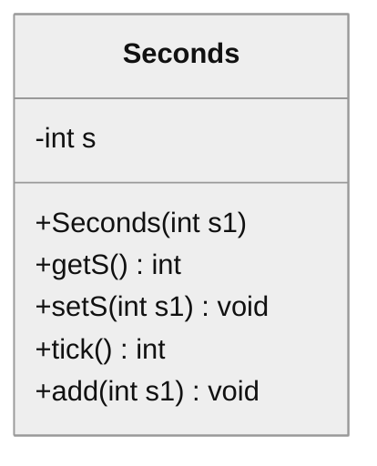
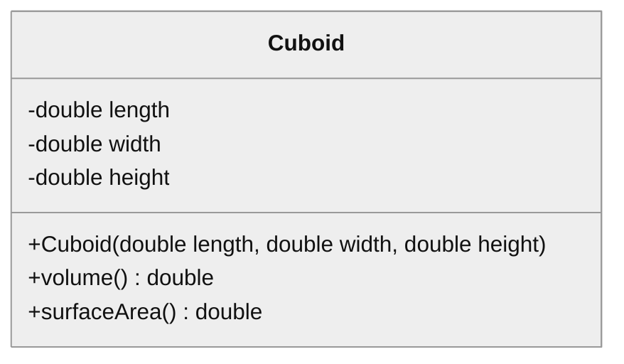

# Введение в ООП. Класс и объект. Абстрактный тип данных

## Мотивация

В языке C типы данных и функции объявляются отдельно. Структура описывает устройство данных, а функции, которые с ней работают, пишутся сами по себе. Ничто не мешает любому коду менять поля структуры напрямую. Рассмотрим простой пример — счётчик с ограничением. Поле `value` хранит текущее значение, поле `limit` — предел, который значение не должно превышать:

```c
/// Счётчик с ограничением
struct Counter {
    int value;   // текущее значение счётчика
    int limit;   // предел: value не должен его превышать
};

// увеличивает value на 1, если предел не достигнут
void counter_inc(struct Counter *c) {
    if (c->value < c->limit)
        c->value++;
}
```

Функция `counter_inc` проверяет предел перед увеличением. Но компилятор не заставляет пользоваться именно этой функцией: любой участок программы может написать `c->value = c->limit + 100;`, и состояние счётчика станет некорректным. Корректность держится только на соглашениях и внимательности программиста.


## 1. Парадигмы программирования

**Парадигма** — подход к организации программы и мышления о ней. В истории программирования парадигмы сменяли друг друга, и каждая решала проблемы предыдущей.

**Структурное программирование** (structured programming) появилось в 1960-е как ответ на программы с беспорядочными переходами. Там использовался оператор `goto`, который переходил к выполнению указанной строки кода. 

Идея структурного программирования — строить программу из следующих конструкций: последовательного выполнения кода, ветвлений и циклов. Оператор `goto` присутствует во многих языках, но согласно этой парадигме его использование можно заменить на вышеописанные конструкции (алгоритмические структуры).

Программа читается сверху вниз, и по ней видно, в каком порядке выполняются действия. В C структурное программирование поддерживается полностью — `if/else`, циклы, — и отказ от `goto` считается хорошим тоном.

**Процедурное программирование** (procedural programming) развивает эту идею: программа — набор процедур (функций), каждая решает свою подзадачу. Данные (структуры, глобальные переменные) и функции, обрабатывающие их, объявляются отдельно. Связи между конкретными данными и конкретными функциями нигде не зафиксированы: любая функция может работать с любыми данными, и следить за корректностью состояния приходится вручную.

**Модульное программирование** (modular programming) — следующий шаг: программа разбивается на модули, каждый модуль предоставляет интерфейс и скрывает внутреннее устройство. В C модуль — это пара файлов `.h` и `.c`: в заголовочном файле объявлены функции модуля, в файле реализации — их код и внутренние данные. Остальной код работает только через интерфейс и не видит внутренностей модуля.

Способ разбиения программы на части называют декомпозицией. Алгоритмическая декомпозиция, которой пользуются структурное и процедурное программирование, разбивает задачу на подзадачи: решение задачи — это процесс, а структуры данных вторичны. Объектно-ориентированная декомпозиция разбивает предметную область на объекты, и задача представляется как взаимодействие этих объектов. Один и тот же код можно разбить по-разному — выбор декомпозиции определяет устройство программы.

**Объектно-ориентированное программирование** объединяет данные и операции над ними (функции) в одном месте — в классе. Доступ к данным контролируется самим классом (его функциями). При росте программы новые классы добавляются рядом с существующими, не перемешиваясь с ними.

| Аспект | C | Python | Java |
|---|---|---|---|
| Единица организации кода | функция | функция или класс по выбору автора | класс |
| Данные и операции над ними | разнесены | можно разнести, можно объединить | объединены в классе |
| Защита состояния | нет | соглашения вида `_name` | модификаторы доступа |
| Что добавляется при росте программы | новые функции и структуры | новые функции и классы | новые классы |

Все перечисленные парадигмы — императивные: программа описывает последовательность *действий*. Есть и декларативные — функциональное и логическое программирование, где описывается, что нужно получить, а способ вычисления остаётся за языком. Python занимает промежуточное положение: классы есть, но ничто не мешает писать в процедурном стиле и обращаться к чужим полям — язык не запрещает. Функциональный стиль в Java тоже присутствует — лямбда-выражения и потоки, — но базовый способ организации кода в языке один, класс.

Подробнее о парадигмах и декомпозиции — в слайдах [OOP_1.0.pdf](../../slides/OOP_1.0.pdf).


## 2. Класс и объект

Класс (class) — тип данных, который создаёт программист. Класс состоит из полей и методов.

Поле (field) — переменная, объявленная внутри класса. У каждого объекта свои значения полей: если класс описывает точку, то у каждой точки свои координаты. Поля хранят состояние объекта.

Метод (method) — функция, объявленная внутри класса. Метод описывает поведение объекта — то, что объект умеет делать. Метод может обращаться к полям своего объекта: читать их и менять. Именно поэтому данные и операции над ними объединяются в одном месте — методы работают с полями того же класса.

Объект (object) — экземпляр класса (instance): сущность в памяти, у которой полям заданы конкретные значения. Если класс определяет набор полей, то в объекте этим полям присвоены значения. Один класс соответствует многим объектам, как чертёж — многим построенным по нему домам.

С точки зрения языка программирования, класс - это тип данных, а объект -- это переменная данного типа.


Определения класса и объекта — в слайдах [OOP_1.0.pdf](../../slides/OOP_1.0.pdf) (раздел «Классы и объекты»).

У объекта выделяют три характеристики:

- состояние (state) — текущие значения полей;
- поведение (behavior) — методы, доступные объекту;
- идентичность (identity) — даже два объекта с одинаковыми полями остаются разными объектами, у каждого своя ячейка в памяти.


| | struct в C | class в Python | class в Java |
|---|---|---|---|
| Данные | да | да | да |
| Методы | нет, функции отдельно | да | да |
| Состав | фиксирован компилятором | поля можно добавлять на ходу | фиксирован компилятором |
| Контроль доступа к полям | нет | соглашение вида `_name` | модификаторы `private`, `protected`, `public` |

Как объект устроен в памяти, разобрано в главе про управление памятью: объект живёт в куче, переменная хранит ссылку на него — [20_memory.md](20_memory.md).

Точку на плоскости удобно описать классом: у неё есть две координаты и операция — расстояние от начала координат. Минимальный, но полный класс на Java выглядит так:

```java
class Point {
    double x;                       // поля — состояние
    double y;

    Point(double x, double y) {        // конструктор — создание объекта
        this.x = x;
        this.y = y;
    }

    double distanceToOrigin() {  // метод — поведение
        return Math.sqrt(x * x + y * y);
    }
}

Point p = new Point(3.0, 4.0);       // объект в куче, p — ссылка на него
p.distanceToOrigin();            // 5.0
```

Класс `Point` описывает точку: поля `x` и `y` хранят координаты, конструктор задаёт их при создании объекта, а метод `distanceToOrigin` вычисляет расстояние от точки до начала координат. Создание объекта и обращение к его методу показаны в двух последних строках.

Конструктор (constructor) — метод, который вызывается при создании объекта и задаёт начальные значения полей.

Синтаксис объявления класса — модификаторы доступа, конструкторы, инициализация полей — разобран в главе [31_oop_classes.md](31_oop_classes.md).


## 3. Абстрагирование. Абстрактный тип данных

Абстракция — один из важнейших принципов ООП: выделение существенных характеристик объекта, игнорирование несущественных. Всего принципов четыре: абстрагирование, инкапсуляция, наследование и полиморфизм. Инкапсуляция разобрана в этой главе, наследование и полиморфизм — в главе про наследование.

Абстрактный тип данных (abstract data type, ADT) описывает тип через набор операций и их контракт, не указывая, как данные устроены внутри. Спецификация отделена от реализации. Классический пример — стек: спецификация задаёт операции `push`, `pop`, `peek`, `isEmpty` и их смысл, а реализаций может быть сколько угодно — на массиве, на связном списке. Клиентский код, написанный против спецификации, не меняется при замене реализации.

Операцию над данными — метод класса — удобно описывать по единому шаблону:

- вход — данные, которые операция получает; может отсутствовать;
- предусловия — требования к входным данным, при соблюдении которых операция может быть выполнена;
- процесс — действия, которые выполняет операция;
- выход — данные, которые операция возвращает; может отсутствовать;
- постусловия — требования к данным, которые должны быть соблюдены после выполнения операции.

В C стек на struct и функциях собрать можно, но ничто не мешает клиенту испортить внутренние данные напрямую. В классе Java реализация закрывается модификаторами доступа — язык поддерживает АТД-мышление синтаксически. Класс в Java — реализация АТД: сначала думаем, что объект умеет, потом — как он устроен.

Не путайте три похожих термина. Абстрагирование — принцип проектирования: выделить существенное и скрыть детали. Абстрактный тип данных — описание типа через операции и их контракт. Абстрактный класс — конструкция языка Java, класс, из которого нельзя создавать объекты; о нём речь в главе про наследование.

Подробнее об АТД — в слайдах [OOP_1.0.pdf](../../slides/OOP_1.0.pdf).


## 4. Предусловия, постусловия, инварианты

Чтобы создать хорошо работающий метод требуется правильно обойтись с тремя вещами. 

Предусловие (precondition) — то, что обязан обеспечить вызывающий код до вызова: корректные аргументы, готовое состояние объекта. Постусловие (postcondition) — то, что метод гарантирует после успешного вызова. Инвариант класса (class invariant) — условие, верное для объекта всегда: сразу после конструктора и после возврата из любого публичного метода.

Предусловие, инвариант класса и постусловие называют контрактом метода. 

Рассмотрим класс `Seconds` из учебных примеров ([examples/java/simple-class](../../examples/java/simple-class)) — он хранит секунды в диапазоне от 0 до 59.

```java
public class Seconds {
    private int s;

    public Seconds(int s1) {
        setS(s1);
    }

    public void setS(int s1) {
        if (s1 >= 60 || s1 < 0) {
            throw new IllegalArgumentException("seconds must be in 0..59");
        }
        this.s = s1;
    }

    // увеличивает число секунд на 1, учитывает переполнение
    public int tick() {
        this.s = (s + 1) % 60;
        return this.s;
    }
}
```

Опишем операцию `setS` по шаблону из раздела 3:

- вход — `s1`, новое значение секунд;
- предусловия — `0 <= s1 <= 59`;
- процесс — `s = s1`;
- выход — нет;
- постусловия — `s` равно `s1`.

Контракт этого класса записывается так:

- предусловие `setS` — аргумент в диапазоне 0..59; при нарушении метод бросает `IllegalArgumentException`;
- постусловие `tick` — значение увеличено на 1, при выходе за 59 отсчёт начинается с нуля;
- инвариант класса — `0 <= s < 60`; он верен после конструктора (который проверяет значение через `setS`) и после любого метода.

В C у функций тоже есть предусловия — валидный указатель, допустимый диапазон, — но записаны они только в документации и в голове программиста, язык не помогает их проверить. В ООП контракт проверяется кодом самого класса: если все поля закрыты и каждый публичный метод поддерживает инвариант, нарушить его извне невозможно.

Такой приём — закрыть поля и открыть доступ к ним только через методы — называется инкапсуляцией  (encapsulation) вместе с сокрытием.

При нарушении предусловия метод бросает исключение. Механизм исключений разобран в главе про исключительные ситуации — [15_exceptions.md](15_exceptions.md).


## 5. UML-диаграмма класса

UML (Unified Modeling Language) — графический язык для описания дизайна программ до написания кода. Сейчас нам нужна диаграмма класса (class diagram): она фиксирует состав класса и видимость членов, с ней удобно обсуждать дизайн до того, как написан код.

Класс изображается прямоугольником из трёх секций — имя, поля, методы. Видимость помечается символом перед именем члена:

| Символ | Видимость в Java |
|---|---|
| `+` | `public` |
| `-` | `private` |
| `#` | `protected` |
| `~` | package-private (без модификатора) |

Типы записываются в UML-стиле `имя : тип`; у метода после скобок указывается возвращаемый тип.

Диаграмма класса `Seconds` из предыдущего раздела:



**Упражнение.** По диаграмме ниже восстановите объявление класса `Cuboid` (прямоугольный параллелепипед) на Java.



Сравните свой вариант с классом `Seconds` — по устройству они должны совпасть с точностью до имён.

Отношения между классами — наследование, агрегация, композиция, ассоциация и зависимость — разобраны в отдельной главе [33_oop_relations.md](33_oop_relations.md).


## Практические советы

- Начинать проектирование со спецификации: какие операции нужны клиенту, какие инварианты.
- Данные держать закрытыми; public-поля — редкое и осознанное решение.
- «Класс-структура» без поведения (только public-поля) — признак процедурного кода в костюме ООП; когда это допустимо, а когда нет.
- Один класс — одна содержательная роль; антимотив: класс, в котором всё.


## Вопросы для самопроверки

1. Чем объектно-ориентированный подход отличается от процедурного? Что меняется в программе при её росте?
2. Чем класс отличается от объекта? Сколько объектов может соответствовать одному классу?
3. Назовите три характеристики объекта и поясните каждую на примере.
4. Почему два объекта с одинаковыми значениями полей — не один и тот же объект?
5. Что такое абстрактный тип данных? Чем спецификация отличается от реализации?
6. Что такое абстрагирование? Приведите пример выделения существенного и сокрытия деталей.
7. Сформулируйте предусловие, постусловие и инвариант для класса `Seconds`.
8. Что произойдёт при вызове `setS(75)`? Какой механизм Java здесь работает?
9. Что означают символы `+`, `-`, `#`, `~` перед именами членов на UML-диаграмме класса?
