# Отношения между классами

В главе «Введение в ООП» мы разобрали, что такое класс и объект, и научились изображать отдельный класс на UML-диаграмме. Программа почти никогда не состоит из одного класса — классы связаны друг с другом. В этой главе разберём виды связей: наследование, агрегацию, композицию, ассоциацию и зависимость, и научимся читать их обозначения на диаграммах.

Отношения между классами удобно разделить на категории, в порядке убывая силы отношения: 
- обобщение и специализация (кошки — это животные), 
- целое и часть (двигатель — часть автомобиля), 
- ассоциация (художник — кисть)
- зависимость (самое слабое отношение, когда один класс лишь пользуется другим).


## 1. Обобщение и специализация

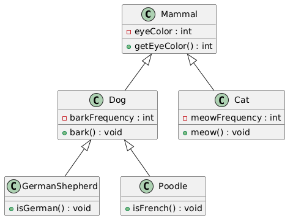

<!--
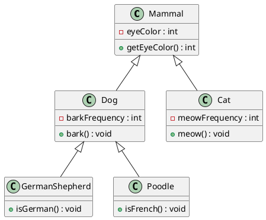
-->

**Наследование** – построение новых классов на основе уже
существующих, при котором один класс (производный) получает все поля и методы базового, а также добавляет свои.

Базовый класс (предок) – класс на основе которого строится
определение нового класса - производного класса (потомка).


## 2. Целое и часть. Агрегация и композиция

**Агрегация (aggregation)** — агрегирующий объект (list на рис. слева) может существовать и не включая в себя экземпляры агрегируемого (в примере atom)

**Композиция (composition)** — один объект (Rectangle на втором рис. слева) не может существовать без своих составляющих (в примере Point) Композиция – более строгий вариант агрегации.

Композиция связывает время жизни объектов: если контейнер будет уничтожен, то всё его содержимое будет также уничтожено.

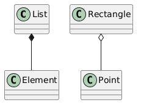

<!--
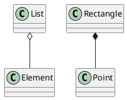
-->


Агрегация: профессора – факультеты, профессора остаются жить после разрушения факультета

Композиция: университет – факультеты, факультеты без
университета погибают.


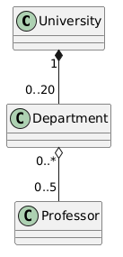

<!--
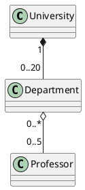
-->


Цифры у концов линии — это мощность связи (multiplicity). Число у конца линии показывает, сколько объектов класса с этого конца приходится на один объект класса с противоположного конца.

В примере выше `0..20` стоит у конца `Department`: один университет состоит из нуля или более (здесь — до 20) кафедр. А `1` у конца `University` означает, что каждая кафедра принадлежит ровно одному университету.

Аналогично `0..5` у конца `Professor` — у кафедры не более пяти профессоров, а `0..*` у конца `Department` — преподаватель может работать в любом числе кафедр.

Обозначения, которые встречаются чаще всего: `1` — ровно один, `0..1` — не более одного (связь необязательна), `0..*` или просто `*` — сколько угодно, `1..*` — хотя бы один.


## 3. Ассоциация и зависимость 

### Зависимость

**Зависимость** (dependency) — отношение при котором изменение одного класса (используемого) может потребовать изменения другого (использующего).
На практике зависимость возникает, когда класс использует другой внутри метода: создаёт объект, получает его как параметр, вызывает статический метод, но не хранит ссылку на него.
Связь существует только во время вызова метода — после возврата из него никакой связи между объектами не остаётся. На диаграмме зависимость изображается пунктирной стрелкой.

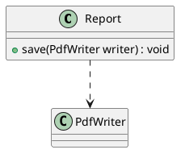

<!--

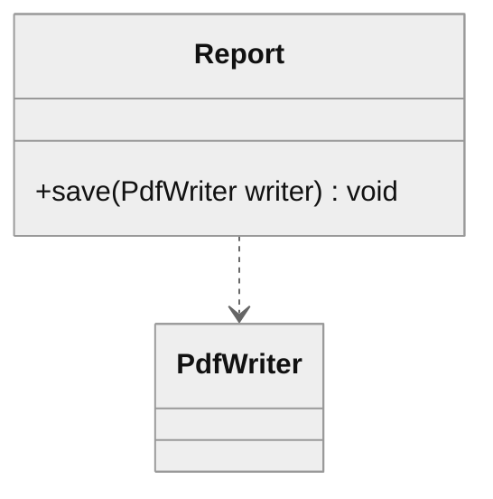
-->

Метод `save` класса `Report` пользуется классом `PdfWriter`, но объект `PdfWriter` не является полем класса Report. Сравните с ассоциацией, где ссылка хранится в поле и существует вместе с объектом.

В коде зависимость выглядит так:

```java
// Используемый класс
/// Класс для записи данных в PDF файл
public class PdfWriter {
    public void write(String text) {
        // записывает текст в PDF-файл
    }
}


/// Класс для генерации отчётов
public class Report {
    public void save(PdfWriter writer) {
        writer.write("Отчёт за ноябрь"); // PdfWriter нужен только внутри метода
    }
}
```

Писатель передаётся в метод `save` как параметр и нигде не сохраняется: после выхода из метода связь между объектами исчезает. В C аналог зависимости — функция, принимающая указатель на объект; в Python — объект, переданный в метод.


### Ассоциация

**Ассоциация** — структурная связь, при которой один класс хранит ссылку на объект другого класса в своём поле, и эта связь существует вместе с объектом. При этом класс не *владеет* объектом. При удалении первого объекта второй продолжит существовать, и по смыслу объект одного класса не является частью другого. 

Ассоциация сильнее зависимости и включает её: храня ссылку в поле, класс тем самым зависит от типа этого поля.
Ассоциация может быть направленной — один класс пользуется вторым классом. Изображается стрелкой от использующего класса к используемому. Если классы используют друг друга на диаграмме изображается линия без стрелок.

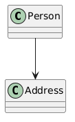

<!--

```plantuml
@startuml
class Person
class Address

Person -- > Address
@enduml
```
-->

В коде ассоциация — это поле-ссылка:

```java
public class Address {
    private String city;
    private String street;

    public Address(String city, String street) {
        this.city = city;
        this.street = street;
    }
}

public class Person {
    private String name;
    private Address address; // ссылка хранится в поле — ассоциация

    public Person(String name, Address address) {
        this.name = name;
        this.address = address;
    }
}
```

Объект `Address` создаётся снаружи и передаётся в конструктор, поэтому `Person` не владеет адресом: один и тот же адрес могут хранить несколько человек, и удаление человека не уничтожает адрес. По смыслу адрес не является частью человека — это ассоциация, а не композиция. В C аналог ассоциации — поле-указатель в структуре, в Python — атрибут.


## 5. Сводная схема

На сводной схеме собраны обозначения всех отношений. Наследование — сплошная линия с пустым треугольником у базового класса, реализация интерфейса — пунктирная линия с пустым треугольником, композиция — линия с закрашенным ромбом у целого, агрегация — с пустым ромбом, ассоциация — простая линия или стрелка, зависимость — пунктирная стрелка.

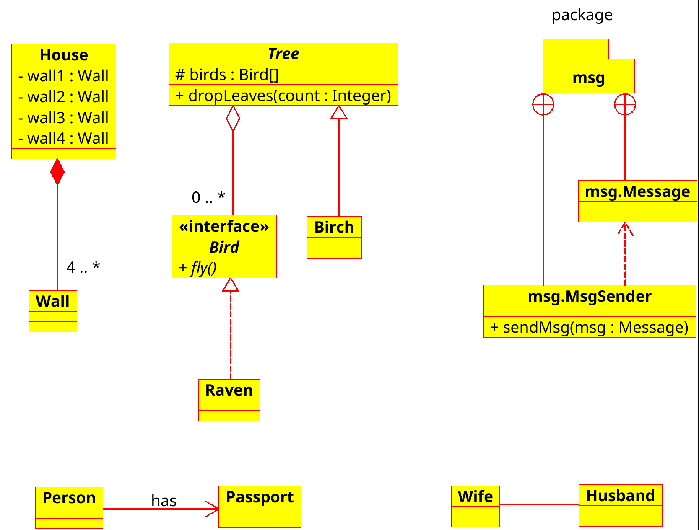


## 6. Примеры

Разберём отношения на классах из учебных примеров.

Класс `Cuboid` (прямоугольный параллелепипед) взят из JavaFX-проекта [JavaFX_Cuboid](../examples/JavaFX_Cuboid); тот же класс без графики есть в обычном Java-проекте [class_example](../examples/class_example):

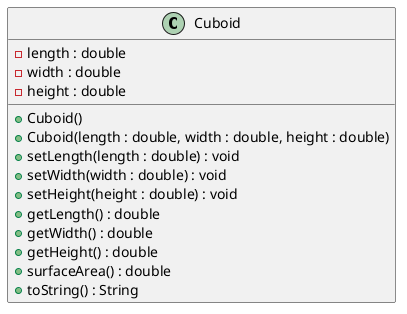

<!--

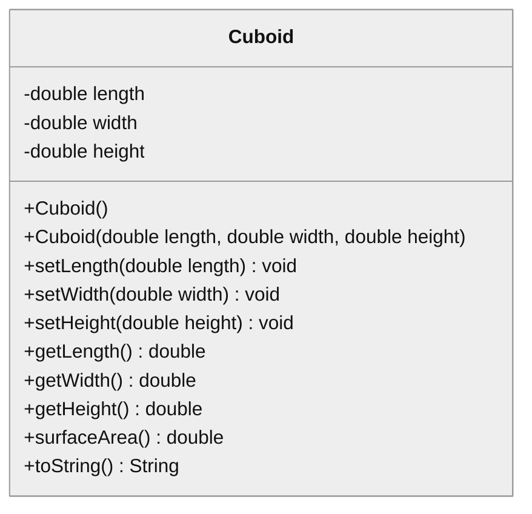
-->

Класс `Seconds` из проекта [simple-class](../../examples/java/simple-class):

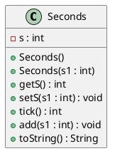

<!--

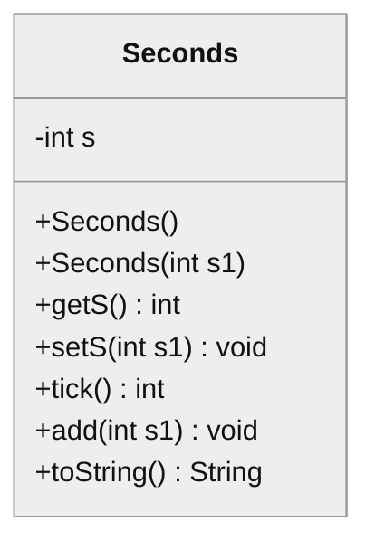
-->

Оба класса — примеры абстрактных типов данных из главы про введение в ООП: поля закрыты, доступ идёт через методы, предусловия проверяются.

Ассоциацию между классами удобно увидеть в том же JavaFX-приложении. Контроллер окна `WindowController` хранит ссылку на объект `Cuboid` и пользуется им при нажатии кнопки:

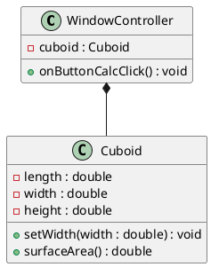

<!--

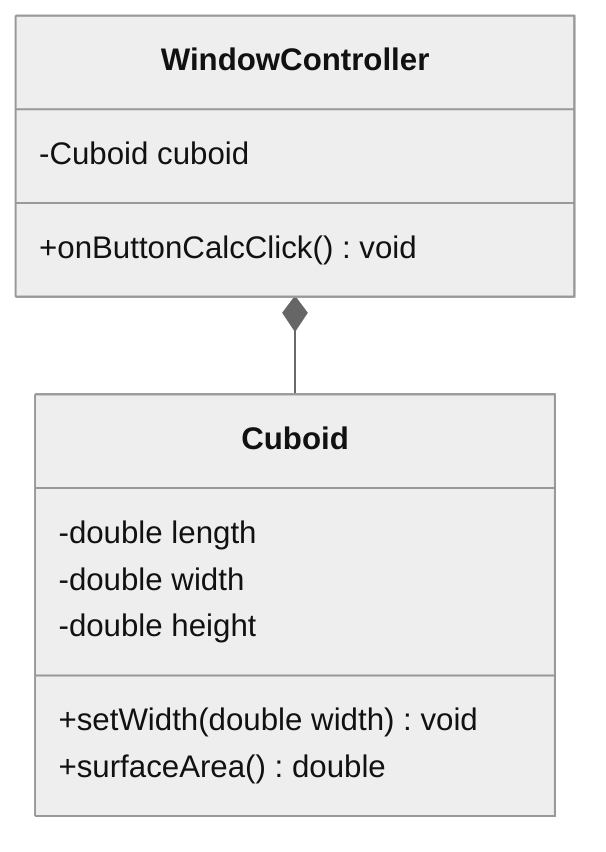
-->

Контроллер сам создаёт объект `cuboid` в поле — это композиция: `WindowController` отвечает за время жизни параллелепипеда. Если бы объект создавался снаружи и передавался контроллеру, это была бы агрегация.


## 7. Сквозной пример

Свяжем понятия раздела в одной иерархии учебного домена — университет, кафедры, преподаватели и предметы:

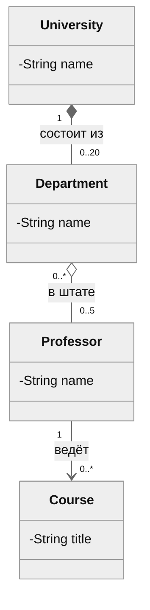

Университет состоит из кафедр — композиция: кафедра не существует без университета. Кафедра и преподаватели — агрегация: преподаватель работает в штате, но переживает расформирование кафедры. Преподаватель и предметы — ассоциация со стрелкой: ссылка на ведущие курсы хранится в объекте преподавателя, но курс не является его частью.

В коде Java композиция и агрегация реализуются одинаково — полями-ссылками. Разница между ними не в синтаксисе, а в ответственности за жизненный цикл: композит сам создаёт свои части и распоряжается ими, при агрегации части создаются снаружи и передаются внутрь. Как объекты и ссылки устроены в памяти — в главе [20_memory.md](20_memory.md).


## Практические советы

- Сначала спрашивайте себя, какая связь по смыслу: «является» — наследование, «имеет» — композиция или агрегация, «пользуется» — ассоциация или зависимость.
- Композиция — более строгая связь, чем агрегация: если целое не может существовать без частей, выбирайте её.
- Если классу нужен другой только внутри метода, не храните ссылку в поле — это зависимость, и так дешевле.
- Наследование — сильная связь, к нему прибегают осознанно; подробнее — в главе про наследование.


## Вопросы для самопроверки

1. Чем композиция отличается от агрегации? Приведите свою пару примеров для каждой связи.
2. Какие связи между классами в парах университет — кафедра, кафедра — преподаватель, художник — кисть?
3. Что означает запись `0..20` у конца линии на диаграмме классов?
4. Как реализуются композиция и агрегация в коде Java и чем различаются?
5. Когда уместно наследование, а когда лучше выбрать агрегацию или композицию?
6. Чем зависимость отличается от ассоциации? Приведите пример из JavaFX-проекта.
7. Класс `WindowController` хранит поле `cuboid` и сам создаёт объект. Какое это отношение?
8. Нарисуйте диаграмму классов для пары «заказ — товар»: заказ содержит список товаров, товар может существовать без заказа. Какая связь и какая мощность?
