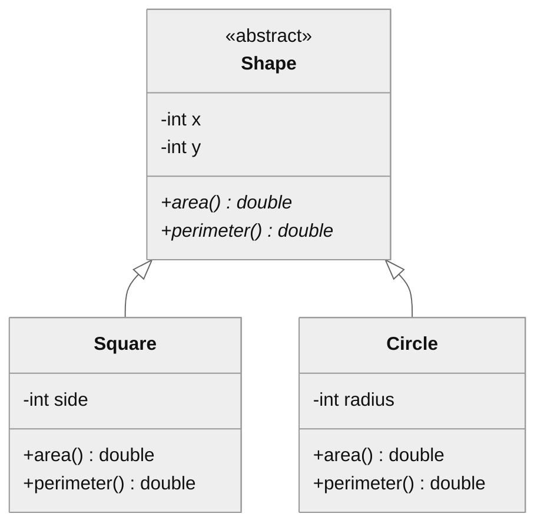
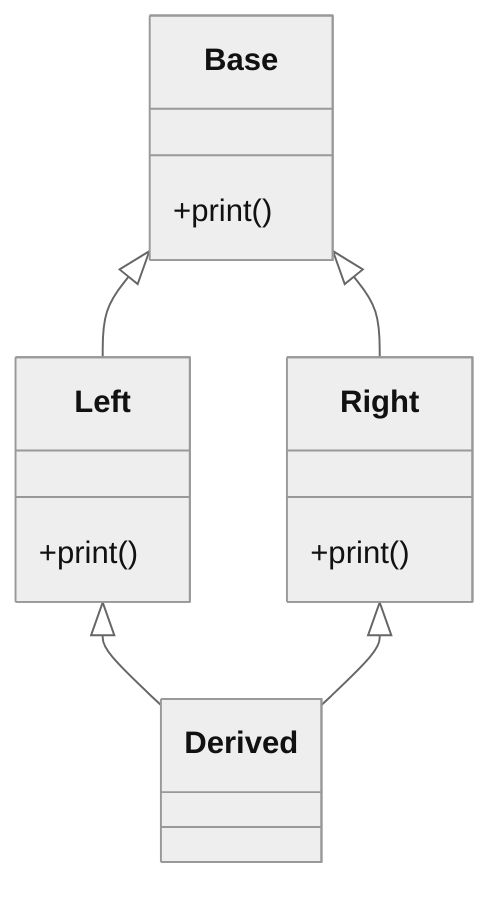

# Наследование. Полиморфизм

В главе «Введение в ООП» наследование было упомянуто вскользь — как одно из отношений между классами, наряду с ассоциацией и композицией. Теперь разберём его подробно: как оно записывается в Java, что именно наследуется, как устроен вызов методов и когда наследование уместно, а когда лучше выбрать другой способ связи классов. Попутно вы научитесь читать и рисовать UML-диаграммы иерархий, переопределять методы и проверять тип объекта во время выполнения.


## Мотивация

В C общие данные между разными «видами» сущностей приходится дублировать вручную. Допустим, у нас есть квадраты и круги, и у каждой фигуры есть позиция и цвет:

```c
struct Square {
    int x, y;          // позиция на плоскости
    char color[16];
    int side;
};

struct Circle {
    int x, y;          // те же поля — скопированы вручную
    char color[16];
    int radius;
};

double square_area(struct Square *s) { return s->side * s->side; }
double circle_area(struct Circle *c) { return 3.14159 * c->radius * c->radius; }
```

С этим кодом сразу возникают проблемы. Поля `x`, `y`, `color` продублированы в каждой структуре, и при добавлении нового общего поля править придётся все структуры сразу — компилятор не подскажет, где вы что-то пропустили. Хуже того, невозможно написать функцию, работающую с любой фигурой. Либо придётся делать две функции для разных фигур. ПОтом добавлять функции если количество структур увеличится. Либо придётся добавлять в структуру тег и писать `switch` (TODO: пояснить), либо хранить в struct указатели на функции. Эти приёмы работают, но оба держат дисциплину на совести программиста и увеличивают количество кода.

В Java и других объектно-ориентированных языках эта проблема решается добавлением специального механизма -- наследования.  Общие поля и методы выносятся в базовый класс, а частные — в производные. В Python наследование тоже есть, но оно динамическое: методы можно подменять на ходу, а ошибки в сигнатурах проявятся только во время выполнения. В Java всё проверяется компилятором ещё до запуска.


## 1. Зачем наследование. Отношение «является»

Наследование (inheritance) — это отношение между классами, при котором один класс строится на основе другого: он получает его поля и методы и добавляет свои. Смысл отношения — "является разновидностью" (is-a) или "является частным случаем". Квадрат является геометрической фигурой, пешка — шахматной фигурой, студент — человеком.


У наследования два эффекта. Первый — повторное использование кода. В производном классе не пишут заново то, что уже есть в базовом. Второй, более важный, — полиморфизм: объект производного класса можно использовать там, где ожидается базовый, и поведение подстроится автоматически. Об этом — в разделе 5.

Класс, от которого наследуют, называют ***базовым*** или предком (в Java часто называют его superclass, суперкласс). Класс, который наследует — ***производный*** или дочерний (subclass, подкласс). В литературе также встречаются термины base class и derived class — это то же самое.

Не всякая связь между классами — наследование. Если класс скорее имеет внутри себя другой (у фигуры есть цвет, у университета есть кафедры), это отношение «имеет» (has-a), и для него подходит композиция. Как выбирать между ними — отдельный вопрос, ему посвящён раздел 9.

На UML-диаграмме наследование изображается сплошной линией с пустым треугольником, направленным к базовому классу. Принцип многих UML диаграмм - стрелка рисуется к тому классу, от которого зависит данный класс соблюдается. Иерархия фигур выглядит так:



Звёздочка у методов `area()` и `perimeter()` означает, что в базовом классе они абстрактные — без реализации. Что это значит, разобрано в разделе 6.


## 2. Синтаксис: extends

Наследование в Java записывается словом `extends`:

```java
// Базовый класс
class Shape {
    int x, y;              // позиция — общая для всех фигур

    double area() { return 0; }
    double perimeter() { return 0; }
}

// Производный класс
class Square extends Shape {
    int side;              // своё поле; x и y достались от Shape

    @Override
    double area() { return side * side; }

    @Override
    double perimeter() { return 4 * side; }
}

class Circle extends Shape {
    int radius;

    @Override
    double area() { return Math.PI * radius * radius; }

    @Override
    double perimeter() { return 2 * Math.PI * radius; }
}
```

Объявление `class Square extends Shape` читается так: Square — это разновидность Shape.

Наследуются поля и методы базового класса. Не наследуются конструкторы — у производного класса свои, и они особым образом связаны с конструкторами предка (раздел 3). private-члены физически присутствуют в каждом объекте производного класса, но обратиться к ним из подкласса нельзя: доступ регулируется модификаторами, а не самим фактом наследования.

Сравнение с другими языками:

| Аспект | C | Java | Python |
|---|---|---|---|
| Механизм | нет; общие данные дублируют в struct или эмулируют вложенными struct и указателями на функции | `extends`, один прямой предок | `class B(A)`, предков может быть несколько |
| Проверки | — | компилятор проверяет сигнатуры и доступ | во время выполнения |
| Вызов метода | — | динамический по умолчанию | динамический |
| Множественное наследование классов | — | нет (только интерфейсы) | есть |


### Модификаторы доступа и наследование

От того, какой модификатор стоит у члена базового класса, зависит, сможет ли подкласс им пользоваться:

| Модификатор | Сам класс | Пакет | Подкласс (в другом пакете) | Весь мир |
|---|---|---|---|---|
| `private` | да | нет | нет | нет |
| без модификатора | да | да | нет | нет |
| `protected` | да | да | да | нет |
| `public` | да | да | да | да |

Модификатор `protected` создан специально для наследования: член виден подклассам, даже если те лежат в другом пакете, но закрыт для постороннего кода. У него есть цена — подкласс начинает зависеть от внутренностей предка, и изменить внутренности предка становится труднее: придётся проверять все подклассы. Поэтому по умолчанию поля делают private, а protected применяют осознанно.


### final и класс Object

`final` перед классом запрещает наследовать его целиком, `final` перед методом — переопределять этот метод. В C++ аналогичные ключевые слова появились только в стандарте C++11; в Java они были с самого начала.

Даже если класс ничего не наследует явно, у него всё равно есть предок — класс `Object`. Поэтому у любого объекта работают `toString()`, `equals()` и `hashCode()` — они определены в `Object`. Мы уже пользовались этим, выводя объекты на печать: `System.out.println(obj)` неявно вызывает `obj.toString()`.


## 3. Конструкторы и super

Объект производного класса содержит внутри себя часть базового класса, и её нужно инициализировать. Поэтому конструкторы выстраиваются в цепочку: сначала отрабатывает конструктор базового класса, затем — производного.

```java
class Shape {
    int x, y;

    Shape(int x, int y) {
        this.x = x;
        this.y = y;
    }
}

class Square extends Shape {
    int side;

    Square(int x, int y, int side) {
        super(x, y);          // вызов конструктора предка — первой строкой
        this.side = side;
    }
}
```

Вызов `super(x, y)` должен быть первой строкой конструктора. Если его не написать, компилятор вставит вызов конструктора базового класса без параметров. Если у базового класса такого конструктора нет, программа не скомпилируется — это частая ошибка после того, как в базовый класс добавили конструктор с параметрами.

В C++ вызов конструктора предка записывается в списке инициализации — `Square(int x, int y, int side) : Shape(x, y), side(side) {}`. В Python конструктор предка вызывают явно — `super().__init__(x, y)`, но забытый вызов компилятор не заметит: объект просто останется недоинициализированным.

Внутри одного класса конструкторы могут вызывать друг друга через `this(...)` — тоже первой строкой. Это избавляет от дублирования инициализации:

```java
Square() {
    this(0, 0, 1);            // значения по умолчанию
}

Square(int x, int y, int side) {
    super(x, y);
    this.side = side;
}
```


## 4. Переопределение методов. @Override

Производный класс может заменить унаследованный метод своей версией. Это называется переопределением (overriding). Не путайте с перегрузкой (overloading) — когда в одном классе несколько методов с одним именем, но разными параметрами.

| | Перегрузка (overloading) | Переопределение (overriding) |
|---|---|---|
| Где происходит | в одном классе (или подкласс добавляет свой вариант) | в подклассе |
| Сигнатура | имя то же, параметры другие | имя и параметры совпадают |
| Когда выбирается метод | при компиляции, по типам аргументов | во время выполнения, по типу объекта |
| Зачем | удобство вызова с разными данными | изменение поведения |

Аннотация `@Override` над методом говорит компилятору, что этот метод должен переопределять метод предка. Если вы ошиблись в имени или параметрах, компилятор сообщит об ошибке. Без аннотации опечатка превращает переопределение в новый метод, и программа молча работает не так, как задумано.

Правила переопределения. Сигнатура должна совпадать с сигнатурой метода предка. Возвращаемый тип может быть подтипом исходного (ковариантность). Доступ нельзя сужать — public-метод нельзя переопределить с меньшей видимостью. Переопределить нельзя `final`-метод, а `static`-методы в динамическом вызове не участвуют (раздел 5).

В C++ динамический вызов включается явно — метод помечают словом `virtual`. В Java все методы динамические по умолчанию, а `final` выключает переопределение. Аннотация `@Override` играет ту же роль, что и `override` из C++11, — защита от опечатки. В Python одноимённый метод просто затирает метод предка, без каких-либо проверок.


## 5. Динамический полиморфизм

Ссылке на базовый класс можно присвоить объект производного — это всегда безопасно, ведь квадрат является фигурой и умеет всё, что умеет фигура:

```java
Shape s = new Square(0, 0, 5);   // ссылка типа Shape на объект Square
```

Такое приведение называют восходящим (upcasting) — по стрелке иерархии вверх. Оно выполняется неявно, без оператора приведения.

Какой метод вызовется в строке `s.area()`? Тип ссылки — Shape, но объект — Square. Java выбирает метод по фактическому типу объекта, а не по типу ссылки. Этот механизм называется динамическим диспетчером методов (dynamic dispatch). У каждого класса есть таблица методов, и вызов `s.area()` означает «вызови area() из таблицы того класса, к которому объект относится на самом деле». Подробно об устройстве объектов в памяти — в главе про память и оператор `new`.

Отсюда главный практический выигрыш наследования. Код, написанный один раз для базового класса, работает со всеми производными:

```java
Shape[] shapes = {
    new Square(0, 0, 5),
    new Circle(10, 10, 3),
    new Square(2, 2, 1)
};

for (Shape s : shapes) {
    System.out.println(s + " площадь " + s.area());
}
```

Ни одного `if` или `switch` — каждый объект сам знает, как считать свою площадь. В C функцию, работающую с «любой фигурой», пришлось бы писать через `switch` по тегу структуры или через указатели на функции внутри struct. Оба варианта требуют правки при добавлении новой фигуры: `switch` надо дописывать, а про указатель на функцию должен позаботиться автор каждой новой структуры. В Java достаточно создать новый класс и переопределить методы — существующий код не меняется.


### Когда динамический вызов не работает

Динамический диспетчер действует только на обычные методы экземпляра. Три случая, где его нет.

Поля выбираются по типу ссылки, а не по типу объекта:

```java
class Shape {
    String name = "фигура";
}

class Square extends Shape {
    String name = "квадрат";   // поле с тем же именем скрывает поле предка
}
```

```java
Square sq = new Square();
Shape sh = sq;                 // обе ссылки указывают на один объект

System.out.println(sq.name);   // квадрат
System.out.println(sh.name);   // фигура — поле берётся по типу ссылки
```

Это называется скрытием поля (field hiding). Вывод простой: объявлять в подклассе поле с тем же именем, что у предка, — почти всегда ошибка проектирования.

Статические методы тоже не переопределяются, а скрываются: их вызов выбирается при компиляции по типу ссылки. private-методы не наследуются вовсе, поэтому и переопределять их нельзя.

В C++ тот же приём выглядит как указатель на базовый класс, в который записан адрес динамически созданного объекта производного класса, — и без `virtual` вызов шёл бы по типу указателя. В Java ссылка на базовый класс и динамический вызов — обычный стиль работы, без ручного управления памятью.


## 6. Абстрактные классы и методы

В иерархии фигур базовый класс сам по себе не имеет смысла. Нельзя нарисовать «просто фигуру» — всегда что-то конкретное. Но убрать Shape нельзя: именно он собирает общее и позволяет писать код, работающий с любой фигурой. Выход — объявить класс абстрактным (abstract):

```java
abstract class Shape {
    int x, y;

    Shape(int x, int y) {
        this.x = x;
        this.y = y;
    }

    abstract double area();          // метод без тела — реализуют подклассы
    abstract double perimeter();

    @Override
    public String toString() {       // обычный метод с реализацией
        return "фигура в точке (" + x + ", " + y + ")";
    }
}
```

Создать объект абстрактного класса нельзя — `new Shape(0, 0)` не скомпилируется. Абстрактный метод (abstract method) объявлен без тела; каждый подкласс обязан реализовать его или сам объявить себя абстрактным.

Заметьте, у абстрактного класса есть поля и конструктор — подклассам нужно из чего собрать объект. В этом отличие от интерфейса, о котором речь в разделе 8.

В C++ та же идея выражается чистой виртуальной функцией — `virtual double area() = 0;`. В Python абстрактные методы оформляют через модуль `abc` или бросают `NotImplementedError` в теле метода, но проверка происходит только при вызове, а не при создании класса.


## 7. Нисходящее приведение и instanceof

Восходящее приведение (от производного класса к базовому) безопасно и неявно. Обратное — нисходящее приведение (downcasting) — компилятор разрешает, но успеха не гарантирует:

```java
Shape s = new Square(0, 0, 5);

Square sq = (Square) s;      // законно: в s действительно квадрат
```

```java
Shape s = new Circle(0, 0, 3);
Square sq = (Square) s;      // скомпилируется, но упадёт во время выполнения
                             // с ClassCastException
```

Проверить фактический тип объекта можно оператором `instanceof`:

```java
if (s instanceof Square) {
    Square sq = (Square) s;
    System.out.println(sq.side);
}
```

Начиная с Java 16 проверку и приведение можно совместить — в одном `if` объявить переменную нужного типа:

```java
if (s instanceof Square sq) {    // переменная sq видна внутри if
    System.out.println(sq.side);
}
```

В C++ для этого есть `dynamic_cast` — при неудаче он возвращает `nullptr` (для указателей) или бросает `bad_cast` (для ссылок). Java-вариант с `instanceof` делает то же самое, а pattern matching убирает ещё и повторное приведение.

Легко злоупотребить `instanceof` и написать цепочку проверок типа — фактически вернуть `switch` по типу, от которого полиморфизм нас избавил. Если вы ловите себя на длинной цепочке `instanceof`, обычно правильнее добавить в базовый класс метод и переопределить его в подклассах. Оправдан downcast тогда, когда в общем коде нужна специфичная операция, которой нет и не должно быть у всех фигур.


## 8. Интерфейсы и множественное наследование типов

Ограничение «один прямой предок» может показаться бедностью Java по сравнению с C++. Но у множественного наследования классов есть известная проблема — ромбовидное наследование (diamond problem):



Класс Derived наследует `print()` от Left и от Right одновременно. Какой из двух вариантов вызывать? В C++ эта неоднозначность требует явного разрешения, а виртуальное наследование добавляет свои тонкости. Java запрещает множественное наследование классов, но позволяет классу реализовать сколько угодно интерфейсов — множественное наследование типов без наследования реализации:

```java
interface Drawable {
    void draw();
}

interface Printable {
    String toText();
}

class Square extends Shape implements Drawable, Printable {
    int side;

    @Override
    public void draw() { /* рисование квадрата */ }

    @Override
    public String toText() { return toString(); }
}
```

С Java 8 интерфейс может содержать методы с реализацией — их помечают словом `default`. Это смягчило старое ограничение «интерфейс — только объявления», но и вернуло проблему ромба в ослабленном виде: если два интерфейса дают разные default-реализации одного метода, класс обязан выбрать сам:

```java
interface A {
    default String hello() { return "привет от A"; }
}

interface B {
    default String hello() { return "привет от B"; }
}

class C implements A, B {
    @Override
    public String hello() {
        return B.super.hello();   // явный выбор реализации
    }
}
```

Интерфейс и абстрактный класс решают разные задачи:

| | Абстрактный класс | Интерфейс |
|---|---|---|
| Поля | любые | только константы (`public static final`) |
| Конструкторы | есть | нет |
| Реализация методов | обычные и абстрактные | `default`-методы |
| Сколько может быть у класса | один предок | сколько угодно |
| Смысл | «что это» — общая основа разновидностей | «что умеет» — контракт способности |

Вы уже пользовались интерфейсами, возможно не задумываясь. `Comparable` и `Comparator` из главы про коллекции — интерфейсы: класс обещает уметь сравниваться, а `Collections.sort` работает с чем угодно, что это обещание выполнило. Тот же приём, что и с Drawable выше.

В терминах ООП интерфейс — это набор операций без привязки к реализации, контракт, который класс берёт на себя. В Java это слово имеет и буквальный синтаксический смысл — конструкция `interface`, — и общий смысл: публичные методы класса тоже образуют его интерфейс в широком смысле.


## 9. Наследование vs композиция

Наследование стоит применять, когда между классами есть настоящее отношение «является». Если связь скорее «имеет» или «пользуется», наследование — неверный инструмент. Альтернатива — композиция: один класс хранит ссылку на другой и делегирует ему работу.

Классический пример из книги «Effective Java» Джошуа Блоха:

```java
import java.util.ArrayList;

// Плохо: стек «является» ArrayList? Нет — стек «имеет» список внутри.
class Stack extends ArrayList<String> {
    void push(String s) { add(s); }
    String pop() { return remove(size() - 1); }
}
```

Формально код работает. Но вместе с `push` и `pop` класс унаследовал весь публичный интерфейс ArrayList: `insert(0, "x")`, `remove(0)`, `set(...)` — операции, нарушающие контракт стека. Клиент сможет испортить стек, а компилятор не возразит. Правильный вариант — композиция:

```java
import java.util.ArrayList;

class Stack {
    private final ArrayList<String> items = new ArrayList<>();

    void push(String s) { items.add(s); }
    String pop() { return items.remove(items.size() - 1); }
}
```


### Принцип подстановки Лисков

Принцип подстановки Барбары Лисков (Liskov substitution principle, LSP) формулирует границу корректного наследования: объект подкласса должен работать везде, где ожидается объект базового класса, не ломая поведение программы. Иначе говоря, подкласс не имеет права усиливать предусловия и ослаблять постусловия методов предка.

Классическая ловушка — «квадрат наследует прямоугольник»:

```java
class Rectangle {
    int width, height;

    void setWidth(int w) { width = w; }
    void setHeight(int h) { height = h; }
    int area() { return width * height; }
}

class Square extends Rectangle {
    @Override
    void setWidth(int w) {
        width = w;
        height = w;    // квадрат обязан сохранять равенство сторон
    }

    @Override
    void setHeight(int h) {
        width = h;
        height = h;
    }
}
```

Кажется логичным: квадрат — частный случай прямоугольника. Но посмотрите на клиентский код, который писался для прямоугольников:

```java
static void stretch(Rectangle r) {
    r.setWidth(5);
    r.setHeight(3);
    // после установки сторон площадь должна стать 15
    if (r.area() != 15) {
        throw new IllegalStateException("прямоугольник испорчен");
    }
}

stretch(new Square());   // упадёт: площадь окажется 9
```

Square нарушил контракт Rectangle — независимую установку сторон. Вывод не в том, что наследование плохое, а в том, что «является» в математическом смысле не всегда «является» в смысле поведения. Проверяйте иерархию не по определениям из учебника геометрии, а по контрактам методов.

Тот же пример иллюстрирует ещё два принципа SOLID. Принцип открытости/закрытости (open/closed principle, OCP): код должен быть открыт для расширения новыми подклассами и закрыт для правки — наш цикл по `Shape[]` именно таков, новая фигура не требует его изменения. Принцип единственной ответственности (single responsibility principle, SRP) мы обсуждали на уровне методов; на уровне классов он означает, что класс отвечает за одну содержательную роль, а не собирает в себе всё.

С Java 17 у дизайнера библиотеки появился способ ограничить иерархию сверху — sealed-класс перечисляет, кому разрешено его наследовать:

```java
public sealed class Shape permits Square, Circle { ... }
```

Это полезно при проектировании библиотек: компилятор знает полный список подклассов, а вы контролируете, кто может расширять ваш класс.


## Практические советы

- ✅ Ставьте `@Override` над каждым переопределённым методом — компилятор поймает опечатку в сигнатуре.
- ✅ Поля делайте private. protected связывает все подклассы с внутренностями предка и затрудняет его изменение.
- ✅ Проектируйте иерархию от контракта — что умеют объекты, — а не от желания переиспользовать код.
- ✅ Проверяйте иерархию принципом Лисков: подкласс должен работать везде, где работает предок.
- ❌ Не наследуйте ради доступа к полям предка — это композиция, а не наследование.
- ❌ Не стройте глубокие иерархии «на всякий случай». Два-три уровня — обычно предел для учебной задачи.
- ❌ Не пишите цепочки `instanceof` там, где достаточно одного виртуального метода.


## Вопросы для самопроверки

1. Что такое наследование и как оно изображается на UML-диаграмме?
2. Приведите пример пары классов с отношением «является» и пары, где наследование будет ошибкой.
3. Что наследуется от базового класса, а что нет? Как связаны конструкторы базового и производного классов?
4. Чем переопределение метода отличается от перегрузки?
5. Зачем нужна аннотация `@Override`? Что произойдёт без неё при опечатке в имени метода?
6. В C++ метод помечают `virtual`, чтобы вызов был динамическим. Что делает вызов динамическим в Java?
7. Какие члены класса не участвуют в динамическом диспетчере? Продемонстрируйте на примере поля.
8. Что такое абстрактный класс и абстрактный метод? Можно ли создать объект абстрактного класса?
9. Чем абстрактный класс отличается от интерфейса? Когда какой выбирать?
10. Как Java решает проблему ромбовидного наследования? Что происходит при конфликте двух default-методов?
11. Что выведет программа, если поле подкласса скрывает поле предка, а ссылка имеет тип предка?
12. Чем нисходящее приведение опаснее восходящего? Как проверить тип перед приведением?
13. Сформулируйте принцип подстановки Лисков и объясните, почему «квадрат наследует прямоугольник» его нарушает.
14. Почему `Stack extends ArrayList` — плохой дизайн? Как его исправить?
