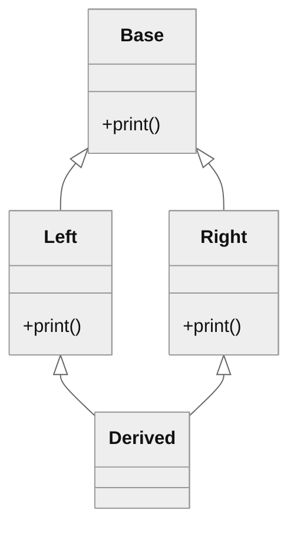

# Интерфейсы в Java

В [главе о наследовании и полиморфизме](35_inheritance.md) общий тип фигур задавался абстрактным классом `Shape`. Абстрактный класс подходит для родственных классов с общими данными или готовым поведением. Но иногда одна способность нужна классам из разных иерархий. Интерфейс позволяет описать такую способность и использовать её без привязки к конкретному классу.

В C похожие задачи решают, например, с помощью указателей на функции. В Python часто достаточно, чтобы объект имел нужный метод. В Java класс явно объявляет, какие интерфейсы он реализует, а компилятор проверяет, что требуемые методы есть.


## 1. Интерфейс как контракт

Интерфейс (interface) — ссылочный тип, который задаёт операции, доступные через этот тип. Класс объявляет реализацию интерфейса с помощью `implements` и предоставляет тела его абстрактных методов.

В примере квадрат и диаграмма не обязаны быть разновидностями одного класса, но оба объекта можно нарисовать. Кроме того, квадрат умеет представлять себя в виде текста:

```java
interface Drawable {
    void draw();
}

interface Printable {
    String toText();
}

class Square implements Drawable, Printable {
    @Override
    public void draw() {
        System.out.println("Рисуем квадрат");
    }

    @Override
    public String toText() {
        return "Квадрат";
    }
}

class Chart implements Drawable {
    @Override
    public void draw() {
        System.out.println("Рисуем диаграмму");
    }
}

class InterfaceExample {
    private static void draw(Drawable object) {
        object.draw();
    }

    public static void main(String[] args) {
        Square square = new Square();
        draw(square);

        Printable text = square;
        System.out.println(text.toText());

        draw(new Chart());
    }
}
```

Метод `draw` принимает любой объект, реализующий `Drawable`. Ему не нужно знать, квадрат это или диаграмма. Переменная `text` имеет тип `Printable`, поэтому через неё доступен `toText()`, но не `draw()`, хотя фактический объект — квадрат. Тип ссылки задаёт доступные операции, а фактический тип объекта определяет реализацию вызываемого метода.

Создать объект самого интерфейса нельзя: `new Drawable()` не скомпилируется. Создают объект конкретного класса, а переменной, параметру или элементу массива можно назначить интерфейсный тип.


## 2. Методы и поля интерфейса

Методы интерфейса без тела неявно являются `public abstract`. Класс, реализующий такой интерфейс, должен объявить соответствующие методы как `public`. Если он не реализует все абстрактные методы, сам класс тоже должен быть абстрактным.

У интерфейса нет конструктора и полей состояния отдельных объектов. Объявленные в нём поля — константы `public static final`. Начиная с Java 8 интерфейс также может содержать методы `default` с реализацией и статические методы. Статический метод вызывают через имя интерфейса, а метод `default` доступен объекту реализующего класса.

```java
interface Describable {
    default String description() {
        return "объект";
    }

    static String category() {
        return "Describable";
    }
}

class Book implements Describable { }

class InterfaceMethodsExample {
    public static void main(String[] args) {
        Book book = new Book();
        System.out.println(book.description());
        System.out.println(Describable.category());
    }
}
```

В Java 9 в интерфейсах также появились закрытые вспомогательные методы. В учебных примерах достаточно знать о них как о возможности языка; ниже используются `default`- и статические методы, доступные с Java 8.


## 3. Несколько интерфейсов и методы `default`

Класс в Java может наследовать один класс, но реализовать несколько интерфейсов. Интерфейс также может наследовать несколько интерфейсов. Так Java поддерживает множественное наследование типов, не разрешая классу наследовать реализацию сразу от нескольких классов.

Проблему множественного наследования классов часто иллюстрируют ромбовидной иерархией. В C++ производный класс может получить два варианта метода от разных родителей:



Методы `default` возвращают часть реализации в интерфейсы. Если класс реализует два интерфейса с одинаковым методом `default`, он обязан переопределить этот метод и выбрать нужную реализацию:

```java
interface A {
    default String hello() {
        return "привет от A";
    }
}

interface B {
    default String hello() {
        return "привет от B";
    }
}

class C implements A, B {
    @Override
    public String hello() {
        return B.super.hello();
    }
}
```

Запись `B.super.hello()` явно выбирает реализацию интерфейса `B`. Если одинаковые сигнатуры есть только у абстрактных методов, одного переопределения в классе достаточно.


## 4. Интерфейс или абстрактный класс

Оба механизма задают общий тип и позволяют использовать динамический полиморфизм, но нужны в разных ситуациях:

| Аспект | Абстрактный класс | Интерфейс |
|---|---|---|
| Состояние | Может хранить поля объекта | Не хранит состояние отдельных объектов; поля — константы |
| Конструктор | Может иметь конструкторы | Конструкторов нет |
| Методы | Может сочетать абстрактные методы и готовую реализацию | Может объявлять абстрактные методы, методы `default` и статические методы |
| Связь классов | Класс может наследовать только один класс | Класс может реализовать несколько интерфейсов |
| Когда подходит | Родственным классам нужны общие данные и реализация | Разным классам нужна общая роль или набор операций |

Абстрактный класс выбирают, когда у родственных типов есть общая часть состояния или поведения. Интерфейс подходит для общей способности, в том числе у классов без общего предка. Эти способы можно сочетать: например, `Square` наследует `Shape` и одновременно реализует `Drawable`.


## 5. Полезные интерфейсы стандартной библиотеки

Интерфейсы часто используют как типы параметров и переменных, чтобы код не зависел от конкретной реализации. Ниже перечислены те, с которыми новичок встретится чаще всего.

| Интерфейс | Что задаёт | Распространённые реализации или применение |
|---|---|---|
| `Collection<E>` | Общие операции для групп элементов; предок `List`, `Set` и `Queue` | `ArrayList`, `HashSet`; `Map` к `Collection` не относится |
| `List<E>` | Упорядоченную последовательность с доступом по индексу; допускает повторяющиеся элементы | `ArrayList`, `LinkedList` |
| `Set<E>` | Набор без повторяющихся элементов; доступа по индексу нет, порядок зависит от реализации | `HashSet`, `TreeSet` |
| `Queue<E>` | Операции очереди; порядок извлечения зависит от реализации | `ArrayDeque`, `PriorityQueue` |
| `Map<K, V>` | Связь ключей со значениями; ключи уникальны, но значения могут повторяться | `HashMap`, `TreeMap`; это отдельная ветвь, не подтип `Collection` |
| `Iterable<E>` | Возможность перебрать элементы циклом `for-each` | Коллекции; метод `iterator()` возвращает `Iterator<E>` |
| `Iterator<E>` | Последовательный перебор элементов через `hasNext()` и `next()` | Явный перебор коллекции |
| `Comparable<T>` | Естественный порядок объектов через `compareTo()` | `String`, числовые классы-обёртки |
| `Comparator<T>` | Отдельное правило сравнения через `compare()` | Сортировка одних объектов по разным критериям |
| `AutoCloseable` | Закрытие ресурса в `try-with-resources` | `Closeable` и другие закрываемые ресурсы |

Особенно нагляден `List`. Это интерфейс, а `ArrayList` — один из классов, который его реализует. Поэтому переменную и параметр метода можно объявить как `List`, а создавать объект выбранной реализации:

```java
import java.util.ArrayList;
import java.util.List;

class ListExample {
    private static void printNames(List<String> names) {
        for (String name : names) {
            System.out.println(name);
        }
    }

    public static void main(String[] args) {
        List<String> names = new ArrayList<>();
        names.add("Анна");
        printNames(names);
    }
}
```

Метод `printNames` зависит от операций интерфейса `List`, а не от устройства `ArrayList`. Поэтому ему можно передать и другую реализацию `List`. Основные операции `List` и класса `ArrayList` разобраны в главе [«Простые коллекции: ArrayList»](60_collections.md).

Ещё одна группа — функциональные интерфейсы, у которых один абстрактный метод. Они служат основой для лямбда-выражений. В стандартной библиотеке часто встречаются `Runnable`, `Predicate<T>`, `Function<T, R>`, `Consumer<T>` и `Supplier<T>`. Их применение лучше разбирать вместе с лямбда-выражениями.


## Практические советы

- Если коду достаточно операций интерфейса, объявляйте переменные и параметры через интерфейс, а не конкретный класс.
- Выбирайте абстрактный класс для общей реализации и состояния родственных классов, интерфейс — для общей роли или способности.
- Не добавляйте интерфейс только ради повторного использования кода; для общей реализации могут лучше подойти абстрактный класс или композиция.
- Помните, что через интерфейсную ссылку доступны только методы этого интерфейса и его предков.


## Вопросы для самопроверки

1. Что такое интерфейс и какую задачу он решает?
2. Как класс объявляет, что реализует интерфейс? Какие методы он обязан определить?
3. Почему нельзя создать объект интерфейса, но можно присвоить интерфейсной ссылке объект класса?
4. Какие методы доступны через переменную типа `Printable`, если объект также реализует `Drawable`?
5. Чем интерфейс отличается от абстрактного класса? Когда уместен каждый вариант?
6. Какие поля и методы может содержать интерфейс? Чем отличаются методы `default` и статические методы?
7. Как класс может разрешить конфликт двух методов `default`?
8. Чем интерфейс `List` отличается от класса `ArrayList`?
9. Для чего нужны `Comparable` и `Comparator`?
10. Назовите несколько полезных интерфейсов стандартной библиотеки и опишите их назначение.
