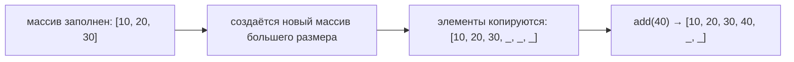

# Простые коллекции: ArrayList

Массивы в Java имеют фиксированный размер. После создания добавить или удалить элемент нельзя, можно лишь создать новый массив и скопировать данные. В C эта проблема решается через `realloc`, в Python списки (`list`) расширяются сами. В Java для этого используется `ArrayList` — самый простой и самый употребимый класс из фреймворка коллекций (пакет `java.util`).

Этот раздел посвящён только `ArrayList`. Остальные коллекции (`LinkedList`, `HashSet`, `HashMap`) и общая архитектура Collections Framework разбираются позже, в разделе о коллекциях и generics.

> В Python есть встроенный список `list`. `ArrayList` устроен почти так же, с одним отличием — тип элементов задаётся заранее.


## 1. Ссылочные типы и классы-обёртки

В разделе [«Управление памятью и оператор new»](20_memory.md) мы разбирали, что переменная примитивного типа хранит само значение, а переменная ссылочного типа — ссылку на объект в куче.

Коллекции Java хранят только ссылки. В объявлении `ArrayList<Integer>` в угловых скобках указывается тип элементов списка. Примитивный тип там указать нельзя, поэтому объявление `ArrayList<int>` не скомпилируется.

Для каждого примитивного типа есть класс-обёртка (wrapper class) — класс, объект которого хранит значение примитива.

- `byte` → `Byte`, `short` → `Short`, `int` → `Integer`, `long` → `Long`
- `float` → `Float`, `double` → `Double`, `char` → `Character`, `boolean` → `Boolean`

Чтобы не упаковывать значения вручную, компилятор выполняет **автоупаковку** (autoboxing) — автоматическое превращение примитива в обёртку, и **автораспаковку** — обратное преобразование:

```java
Integer a = 42;          // автоупаковка: int → Integer
int b = a;               // автораспаковка: Integer → int
```

Подробнее про обёртки и сравнение `==` с `equals` — в разделе [«Преобразование типов»](12_expr_cast.md).


## 2. ArrayList — динамический массив

`ArrayList<E>` — это аналог классического массива, но с удобным и автоматическим управлением размером. Внутри он хранит обычный массив, а когда тот заполняется — создаёт новый большего размера и копирует элементы.

`E` — параметр типа (generics). Он задаёт, какой тип хранится в списке. Generics будут подробно разобраны позже, а пока можно понимать `<E>` как заглушку в шаблоне, которая при использовании ArrayList будет заменена на конкретный тип. Например, `ArrayList<Integer>` — это список чисел.

### Почему ArrayList называется списком

Слово List в названии может сбить с толку. Список вы, скорее всего, знаете как структуру из узлов, связанных ссылками (в C вы, вероятно, строили такую своими руками). Но `ArrayList` — не связный список.

`List` здесь — это интерфейс `java.util.List`. Интерфейс описывает, что умеет структура данных, но не уточняет, как она устроена. Для List это упорядоченная последовательность элементов с доступом по индексу. Класс, реализующий интерфейс, обязан обеспечить такое поведение, а внутреннее устройство остаётся на его усмотрение.

`ArrayList` — одна из реализаций List, внутри которой лежит массив. Название так и зашифровано: Array + List, массив, работающий как список. Связный список из узлов в Java тоже есть — класс `LinkedList`. Он реализует тот же интерфейс List, но хранит элементы в узлах со ссылками. Обе структуры взаимозаменяемы в коде, рассчитанном на List, хотя устроены по-разному. Подробное сравнение — в разделе о коллекциях.


### Создание и базовые операции

```java
import java.util.ArrayList;

ArrayList<Integer> numbers = new ArrayList<>(); // пустой список чисел

numbers.add(10);             // добавление в конец — O(1) в среднем; 10 автоупаковывается
numbers.add(20);
numbers.add(30);

int first = numbers.get(0);  // доступ по индексу — O(1); Integer автораспаковывается
System.out.println(first);   // 10
numbers.set(1, 25);          // замена элемента по индексу
numbers.remove(2);           // удаление по индексу — O(n), элементы сдвигаются

int size = numbers.size();   // текущее количество элементов (не путать с length!)

System.out.println(numbers); // [10, 25] — списки печатаются сами, Arrays.toString не нужен
```

В комментариях встречаются оценки времени работы. O(1) — постоянное время, не зависящее от количества элементов в списке. O(n) — время, растущее пропорционально количеству элементов.

Когда внутренний массив заканчивается, `ArrayList` увеличивает его:



Рост массива обходится дорого, но происходит редко, поэтому `add` в среднем работает за O(1).

### Операции массива и ArrayList

| Операция | Массив | ArrayList |
|----------|--------|-----------|
| Размер | `arr.length` (поле) | `list.size()` (метод) |
| Чтение по индексу | `arr[i]` | `list.get(i)` |
| Запись по индексу | `arr[i] = x` | `list.set(i, x)` |
| Добавление в конец | нет (нужен новый массив) | `list.add(x)` |
| Удаление элемента | нет | `list.remove(i)` |


## 3. Перебор списка

```java
// цикл по индексу — как с массивом
for (int i = 0; i < numbers.size(); i++) {
    System.out.println(numbers.get(i));
}

// for-each — работает с любой коллекцией; Integer автораспаковывается в int
for (int x : numbers) {
    System.out.println(x);
}
```


## 4. Ввод заранее неизвестного количества чисел

Типичный сценарий для `ArrayList` — чтение данных, количество которых заранее неизвестно.

```java
import java.util.ArrayList;
import java.util.Scanner;

public class SumExample {
    public static void main(String[] args) {
        Scanner in = new Scanner(System.in);
        ArrayList<Integer> numbers = new ArrayList<>();

        System.out.println("Введите числа (0 — конец ввода):");
        while (true) {
            int x = in.nextInt();
            if (x == 0) break;
            numbers.add(x);   // автоупаковка
        }

        int sum = 0;
        for (int x : numbers) {
            sum += x;
        }
        System.out.println("Чисел: " + numbers.size() + ", сумма: " + sum);
    }
}
```

С обычным массивом пришлось бы заранее выделять память с запасом и вести отдельный счётчик заполненных ячеек.

Однако если количество элементов известно заранее, то лучше будет создать массив такого размера заранее, чтобы избежать временами возникающего перекопирования элементов во время добавления данных.

В `ArrayList` место под элементы тоже резервируется заранее — ожидаемое количество передаётся конструктору.

```java
ArrayList<Integer> numbers = new ArrayList<>(1000); // резервируется место под 1000 элементов

System.out.println(numbers.size()); // 0 — элементов в списке пока нет
```

Здесь важно не перепутать две величины. Размер списка (`size()`) — сколько элементов реально лежит в списке. Ёмкость (capacity) — размер внутреннего массива, то есть сколько элементов в него поместится без перекопирования. Конструктор с числом задаёт именно ёмкость. Поэтому у только что созданного списка `size()` равен нулю, а `numbers.get(0)` бросит `IndexOutOfBoundsException` — элементов в списке нет, как и в созданном через `new int[1000]`, но не заполненном массиве.

Если нужно, чтобы в списке сразу было n значений, их добавляют циклом. Благодаря зарезервированной ёмкости добавления не вызывают перекопирования.

```java
ArrayList<Integer> numbers = new ArrayList<>(n);
for (int i = 0; i < n; i++) {
    numbers.add(0);
}
```

У уже созданного списка ёмкость увеличивает метод `ensureCapacity(n)`, но на практике обычно хватает конструктора.


## 5. Преобразование между массивом и ArrayList

Массив и ArrayList преобразуются друг в друга, но в одной из этих операций есть тонкость.

```java
import java.util.ArrayList;
import java.util.Arrays;
import java.util.List;

Integer[] arr = {1, 2, 3};

// массив → List
List<Integer> fixed = Arrays.asList(arr);   // List поверх массива, без копирования

// массив → ArrayList
ArrayList<Integer> list = new ArrayList<>(Arrays.asList(arr));

// ArrayList → массив
Integer[] back = list.toArray(new Integer[0]);
```

Тонкость в том, что `Arrays.asList(arr)` не создаёт новую коллекцию с собственным хранилищем, а лишь оборачивает исходный массив объектом, реализующим List. Размер такого List изменить нельзя — ни добавить элемент, ни удалить. А чтение и запись элементов идут напрямую в исходный массив.

```java
fixed.set(0, 100);           // запись через List
System.out.println(arr[0]);  // 100 — изменился исходный массив
```

Поэтому если нужен независимый список, массив копируют в новый `ArrayList`, как во второй строке первого примера.


## 6. Когда использовать ArrayList, а когда — обычный массив?

| Ситуация | Что выбрать |
|----------|-------------|
| Размер известен заранее и не меняется | Обычный массив (`int[]`) |
| Элементы добавляются/удаляются в процессе | `ArrayList` |
| Критична производительность и кэш-локальность | Обычный массив |

> В современном Java-коде `ArrayList` используется значительно чаще, чем обычные массивы. Если не уверены — берите `ArrayList`. Перейти с `ArrayList` на массив легко, а наоборот — труднее.


## Практические советы

- ✅ Используйте `ArrayList` как контейнер по умолчанию для последовательностей элементов.
- ✅ Для вывода списка достаточно `System.out.println(list)` — в отличие от массивов, у списков есть осмысленный `toString()`.
- ❌ Не путайте `length` (поле массива) и `size()` (метод коллекции).
- ❌ Не сравнивайте элементы-обёртки через `==` — для объектов используйте `equals()` (см. [«Преобразование типов»](12_expr_cast.md)).
- ❌ Не удаляйте элементы из списка во время перебора for-each — Java бросит `ConcurrentModificationException` (см. [«Исключения»](15_exceptions.md)). Удаляйте в цикле по индексу, идя с конца.


## Вопросы для самопроверки

1. Почему `ArrayList<int>` не компилируется, а `ArrayList<Integer>` — да?
2. Что делает компилятор с вызовом `numbers.add(42)`, где `numbers` — это `ArrayList<Integer>`? Как называется это преобразование?
3. Чем `size()` отличается от `length`?
4. В чём ключевое отличие обычного массива от `ArrayList`?
5. В какой ситуации обычный массив `int[]` будет лучше `ArrayList<Integer>`?
6. Почему класс называется ArrayList, хотя внутри он устроен как массив?
